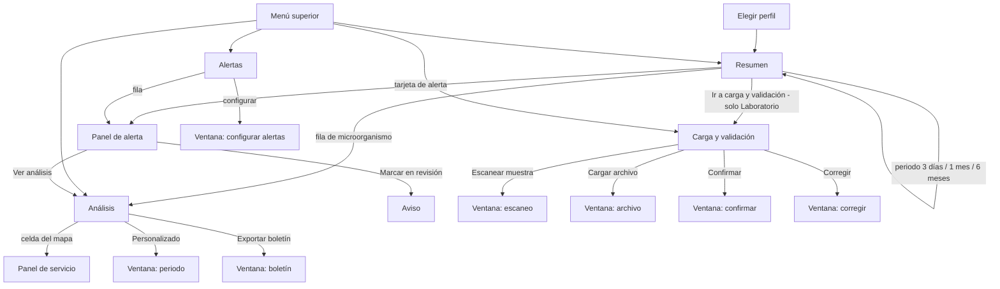

# Vigía RAM · prototipo v0.5

Prototipo navegable de la plataforma **Vigía RAM** (vigilancia de resistencia antimicrobiana), proyecto de tesis RAM, Pontificia Universidad Javeriana.

> **Estado:** propuesta de diseño, **sin aprobación del equipo ni de la asesora**. Todos los datos, pacientes y cifras son ficticios. No fija alcance: lo no confirmado sigue pendiente (ver [Límites y pendientes](#límites-y-pendientes)).

## Cómo verlo

- En línea: <https://tesisram.github.io/prototipoVigiaRAM/> (GitHub Pages).
- Local: abrir [`vigia-ram-flujo.html`](vigia-ram-flujo.html) con doble clic. Es un solo archivo, sin servidor; solo la fuente Poppins necesita internet.

Dentro del prototipo, el selector de perfil junto a la campana cambia de rol. El panel **Guía del recorrido** (se oculta con la ×) lista los flujos F1 a F5 de abajo y abre la pantalla de cada paso. Los filtros, buscadores y selectores muestran el aviso «no incluido».

## Qué incluye la v0.5

- 4 pantallas de escritorio: **Resumen**, **Alertas**, **Análisis y mapa**, **Carga y validación**.
- 5 perfiles de consulta: Laboratorio, Comité de infecciones, PROA, Farmacia y Dirección científica.
- Capas: paneles laterales de alerta y de servicio, ventanas (periodo, boletín, archivo, escaneo, confirmar, corregir, configurar alertas), menú de perfil y avisos.

## Fuentes que sustentan el flujo

| Fuente | Qué aporta |
|---|---|
| Reunión con la asesora, 2026-11-09 | Perfiles de consulta, 3 tipos de alerta, resumen legible en 3 a 5 min, listado por periodo, mapa por servicios, cero digitación, dato inválido marcado y confirmado, alcance de un solo hospital |
| Requerimientos candidatos de vigilancia de CIM | CIM cerca del punto de corte, historial de 6 meses |
| Notas de conocimiento (flujo microbiológico, gobernanza, sistemas y calidad de datos) | Origen del dato (lector, Vitek 2, Equipo de Identificación), calidad y confirmación |

## Perfiles y qué ve cada uno

| Perfil | Navegación | Alertas visibles | Carga de datos |
|---|---|---|---|
| Laboratorio | Resumen · Alertas · Análisis · Carga y validación | Operativas, calidad y vigilancia (3 pestañas) | Sí |
| Comité de infecciones | Resumen · Alertas · Análisis | Solo vigilancia | No |
| PROA | Resumen · Alertas · Análisis | Solo vigilancia | No |
| Farmacia | Resumen · Alertas · Análisis | Solo vigilancia | No |
| Dirección científica | Resumen · Alertas · Análisis | Solo vigilancia | No |

Alertas abiertas por perfil en el ejemplo: Laboratorio 8 (2 críticas), Comité 6, PROA 3, Farmacia 2, Dirección 3.

## Mapa de navegación

## Flujos paso a paso

### F1 · Consulta diaria (3 a 5 min)
1. Entra y ve el **Resumen** de su perfil (periodo por defecto: 3 días).
2. Lee los indicadores, el listado de microorganismos más frecuentes y las alertas abiertas.
3. Cambia el periodo (3 días / 1 mes / 6 meses) si necesita contexto; el historial llega a 6 meses.
4. Abre una alerta o un microorganismo para profundizar. Si no necesita más, termina ahí.

### F2 · De la alerta al análisis
1. En **Alertas** (o en el Resumen) abre una alerta: se despliega el **panel** con qué pasó, desde cuándo, casos y siguiente paso.
2. **Ver análisis** lleva a Análisis con el contexto de esa alerta.
3. **Marcar en revisión** muestra un aviso (en el prototipo no cambia el estado).
4. Laboratorio filtra por pestaña: operativas, calidad, vigilancia. Los demás perfiles ven solo vigilancia, con columna «Tipo».

### F3 · Análisis encadenado y mapa
1. Elegir microorganismo → distribución por tipo de muestra → por servicio → por antibiótico (selectores encadenados).
2. El **mapa del hospital** colorea cada servicio por nivel; tocar una celda abre el panel del servicio.
3. La gráfica de CIM marca el punto de corte para ver los aislamientos cercanos.
4. **Personalizado** abre la ventana de periodo; **Exportar boletín** abre la ventana de exportación (formato legible tipo boletín del INS).

### F4 · Carga y validación sin digitar (solo Laboratorio)
1. Los resultados llegan por **lector de código de barras**, **interfaz con equipos** (Vitek 2, Equipo de Identificación) o **archivo**; el código manual es solo respaldo.
2. La **cola de validación** separa Todos / Por confirmar / Con error.
3. Un dato inválido **no se descarta**: se marca con el motivo (CIM fuera de rango, falta CIM, valor atípico) y espera.
4. La persona del laboratorio abre **Confirmar** (acepta el dato tal cual) o **Corregir**.
5. El resumen de calidad muestra completitud y conteo de válidos, por confirmar y con error.

### F5 · Configurar alertas
Desde Alertas, **configurar** abre la ventana con los umbrales propuestos (ejemplo visual; no hay pantalla de inicio de sesión ni de administración).

## Trazabilidad reunión → pantalla

| Lo hablado en la reunión | Dónde está en el prototipo |
|---|---|
| Panel por perfil | Resumen y menú de perfil |
| 3 tipos de alerta | Alertas (pestañas en Laboratorio) |
| Lectura de 3 a 5 min, estilo boletín | Resumen + ventana de boletín |
| Microorganismo más frecuente, 3 días / 1 mes | Resumen y selector de periodo |
| Distribución por tipo de muestra | Análisis |
| Historial de 6 meses | Periodo «6 meses» |
| Mapa por servicios | Análisis (mapa + panel de servicio) |
| CIM cerca del punto de corte | Análisis, gráfica de CIM |
| Sin digitación manual | Carga: lector, interfaz, archivo |
| Dato inválido marcado y confirmado | Cola de validación, Confirmar / Corregir |
| Un solo hospital | Todo el prototipo |

## Límites y pendientes

- No hay pantalla de «uso de antibióticos por piso» (la alerta de meropenem en UCI la sugiere).
- Filtros y selectores solo muestran aviso; confirmar o marcar en revisión no cambia el estado visible.
- Carga de datos solo diseñada para Laboratorio; sin inicio de sesión ni administración de umbrales.
- Pendiente de decisión del equipo: datos reales vs sintéticos, aprobación ética, alcance final de perfiles.
